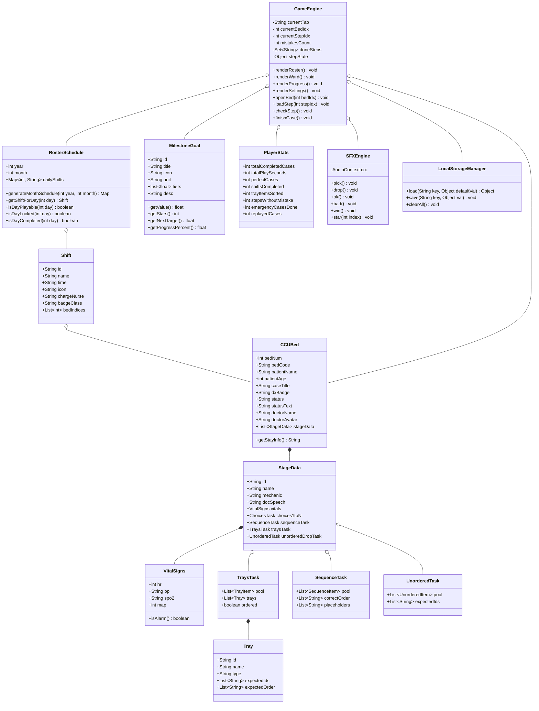

# แผนภาพคลาส (Class Diagram)
## โครงการ: A-WARD CCU (CCU Nursing Simulation Game)

---

### 1. คำอธิบายสถาปัตยกรรมเชิงคลาส (Architecture Overview)
โครงสร้างโปรแกรมถูกออกแบบแบบ Object-Oriented และ Data-Driven Architecture ประกอบด้วย:
- **Core Entities:** ข้อมูลเตียงคนไข้ (`CCUBed`), สัญญาณชีพ (`VitalSigns`), ขั้นตอนหัตถการ (`StageData`), และภารกิจ Drag & Drop (`SequenceTask`, `TraysTask`, `UnorderedTask`)
- **Shift & Progression Models:** ข้อมูลเวรประจำวัน (`Shift`), ปฏิทินเวร (`RosterSchedule`), และเป้าหมายสะสมดาว (`MilestoneGoal`)
- **Game Engine & UI State:** ตัวควบคุมลอจิกแอป (`GameEngine`), ระบบเสียงสังเคราะห์ Web Audio (`SFXEngine`), และตัวบันทึกข้อมูลเบราว์เซอร์ (`LocalStorageManager`)

---

### 2. แผนภาพ Class Diagram (Mermaid)

---

### 3. คำอธิบายคลาสหลัก (Class Descriptions)

1. **`CCUBed`**: ข้อมูลเตียงคนไข้ CCU ทั้ง 8 เตียง รายละเอียดโรค แพทย์ผู้ดูแล และชุดข้อมูลหัตถการ 6 ขั้นตอน
2. **`StageData`**: ขั้นตอนการทำหัตถการแต่ละขั้น บรรจุโจทย์ สัญญาณชีพ คำพูดแพทย์ และชนิดภารกิจ Drag & Drop
3. **`TraysTask` / `SequenceTask` / `UnorderedTask`**: โครงสร้างภารกิจจัดเตรียมอุปกรณ์ลงถาดหลายใบ, เรียงลำดับเครื่องมือให้หมอ, และเลือกการพยาบาลที่ปลอดภัย
4. **`Shift` / `RosterSchedule`**: ระบบตารางเวรหมุนเวียน (เช้า/บ่าย/ดึก/Off) ตรวจสอบเงื่อนไขการเล่นเรียงวัน และการล็อกเวร
5. **`MilestoneGoal` / `PlayerStats`**: ระบบบันทึกสถิติ 20 เป้าหมาย คำนวณดาวและเปอร์เซ็นต์ของหลอดพลังความก้าวหน้า
6. **`GameEngine`**: ตัวควบคุมหน้าจอและการโต้ตอบของผู้เล่น (Tabs, Modal, Feedback Sheet, Stepper)
7. **`SFXEngine`**: สังเคราะห์คลื่นเสียง (Sine, Triangle wave) ด้วย Web Audio API สำหรับเสียง Pop, Click, Star, Confetti
