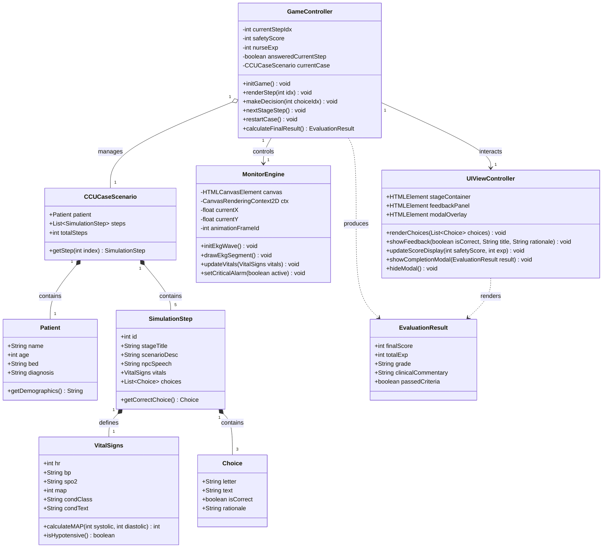

# แผนภาพคลาส (Class Diagram)
## โครงการ: A-WARD (CCU Nursing Simulation Game)

---

### 1. คำอธิบายสถาปัตยกรรมเชิงคลาส (Architecture Overview)
สถาปัตยกรรมของ A-WARD ถูกออกแบบตามหลัก Object-Oriented Design และ Separation of Concerns เพื่อให้การจัดการจำลองสถานการณ์ทางคลินิก (Clinical Simulation State), การแสดงผลสัญญาณชีพ (Vitals & Canvas Engine), และตัวขับเคลื่อนเคสการตัดสินใจ (Case Scenario Engine) มีความเป็นโมดูลาร์สูง

---

### 2. แผนภาพ Class Diagram (Mermaid)

---

### 3. คำอธิบายรายละเอียดคลาส (Class Specifications)

#### 3.1 กลุ่ม Model / Data Entities
- **`Patient`**: ข้อมูลประชากรศาสตร์ของผู้ป่วย เช่น ชื่อ นามสกุล อายุ เตียง และการวินิจฉัยโรคเบื้องต้น (เช่น STEMI Post-PCI)
- **`VitalSigns`**: สัญญาณชีพของผู้ป่วยในแต่ละสถานะ (Heart Rate, NIBP, SpO2, Mean Arterial Pressure) พร้อมคลาส CSS กำกับระดับความรุนแรง (Stable, Warning, Critical)
- **`Choice`**: ตัวเลือกการตัดสินใจ (A, B, C) พร้อมการระบุคำตอบที่ถูกต้อง และคำอธิบายเชิงคลินิก (Clinical Rationale)
- **`SimulationStep`**: องค์ประกอบของแต่ละสถานการณ์จำลอง (คำอธิบายเหตุการณ์, บทพูดของ Charge Nurse, สัญญาณชีพ และตัวเลือก)
- **`CCUCaseScenario`**: อ็อบเจกต์รวบรวมเคสผู้ป่วยและขั้นตอนทั้งหมดในสถานการณ์

#### 3.2 กลุ่ม Controller & Engine
- **`GameController`**: สมองหลักในการควบคุม Flow ของเกม จัดการ State ปัจจุบัน บันทึกคะแนน Patient Safety และคะแนน EXP ตรวจสอบคำตอบ และสลับขั้นตอน
- **`MonitorEngine`**: ระบบเรนเดอร์สัญญาณชีพและคลื่นหัวใจ Canvas วาดรูปคลื่น P-QRS-T แบบไดนามิกตามรอบ Loop ความถี่สูง
- **`UIViewController`**: จัดการ DOM ในหน้าเว็บ ปรับปรุงข้อความ สไตล์ปุ่ม การเปิด/ปิด Feedback Panel และ Result Modal
- **`EvaluationResult`**: อ็อบเจกต์สรุปผลลัพธ์การประเมินทักษะทางการพยาบาลเมื่อจบเคส
