# แผนภาพความสัมพันธ์เอนทิตี (Entity-Relationship Diagram: ER Diagram)
## โครงการ: A-WARD CCU (CCU Nursing Simulation Game)

---

### 1. บทนำและสถาปัตยกรรมข้อมูล (Data Architecture Overview)
ระบบฐานข้อมูลและการจัดเก็บสถานะ (Data Persistence) ของแอปพลิเคชัน **A-WARD CCU** ถูกออกแบบให้รองรับทั้ง:
1. **Clinical & Simulation Metadata (Master Data):** ข้อมูลเตียงคนไข้ใน CCU, สัญญาณชีพ, ขั้นตอนหัตถการ 6 ขั้นตอน และภารกิจ Drag & Drop (ถาดอุปกรณ์, การเรียงลำดับ, ชอยส์ตัวเลือก)
2. **Shift Roster & Calendar Schema:** ตารางเวรพยาบาลประจำเดือน, การจัดสรรเตียงตามเวร และประวัติการขึ้นเวรประจำวัน
3. **Player Progress & Milestones Store (Transactional / Client LocalStorage):** ความก้าวหน้าการสะสมดาวของแต่ละเตียง, การปลดล็อกวันในปฏิทิน, สถิติการเล่น และสถานะความสำเร็จของ 20 Milestones

---

### 2. แผนภาพ ER Diagram (Mermaid erDiagram)

```mermaid
erDiagram
    %% Master Entities: Bed & Patient
    CCU_BED ||--o{ PATIENT_STAY_INFO : "has"
    CCU_BED ||--|{ PROCEDURE_STAGE : "contains 6 steps"
    
    CCU_BED {
        int bed_num PK "หมายเลขเตียง (1-8)"
        string bed_code "รหัสเตียง เช่น 'เตียง 01 CCU'"
        string patient_name "ชื่อ-นามสกุลผู้ป่วย"
        int patient_age "อายุผู้ป่วย"
        string case_title "ชื่อเคสหัตถการ"
        string dx_badge "ป้ายการวินิจฉัยโรค เช่น STEMI Post-PCI"
        string status "สถานะเตียง (alert, critical, warning)"
        string status_text "ข้อความสถานะ เช่น 'เฝ้าระวังแผล'"
        string doctor_name "ชื่อแพทย์เจ้าของไข้"
        string doctor_avatar "ไอคอนแพทย์ (👨‍⚕️, 👩‍⚕️)"
    }

    PATIENT_STAY_INFO {
        int bed_num FK "อ้างอิงหมายเลขเตียง"
        string stay_duration "ระยะเวลานอน CCU เช่น 'วันที่ 2 ใน CCU'"
        string clinical_note "บันทึกสรุปทางคลินิกประจำวัน"
    }

    %% Master Entities: 6-Step Clinical Procedure
    PROCEDURE_STAGE ||--|| VITAL_SIGNS : "monitored by"
    PROCEDURE_STAGE ||--o{ TASK_ITEM : "provides pool"
    PROCEDURE_STAGE ||--o{ TRAY_CONTAINER : "allocates"

    PROCEDURE_STAGE {
        string stage_id PK "รหัสขั้นตอน เช่น 's1', 's2'"
        int bed_num FK "อ้างอิงหมายเลขเตียง (1-8)"
        int step_index "ลำดับขั้นตอน (0-5 หรือ ขั้นที่ 1-6)"
        string name "ชื่อขั้นตอน เช่น '1. เตรียมความพร้อมผู้ป่วย'"
        string mechanic "ประเภทกลไกการเล่น (ชอยส์, ถาด, ลำดับ)"
        string doc_speech "บทพูดคำสั่งของแพทย์"
        string reading_summary "หัวข้อเอกสารทางการแพทย์ให้อ่าน"
        text reading_detail "รายละเอียดความรู้ทางการพยาบาล"
    }

    VITAL_SIGNS {
        string stage_id FK "อ้างอิงรหัสขั้นตอน"
        int heart_rate "อัตราการเต้นของหัวใจ (bpm)"
        string blood_pressure "ความดันโลหิต (mmHg) เช่น '118/74'"
        string spo2 "ความอิ่มตัวออกซิเจน เช่น '98%'"
        int map_pressure "ความดันหลอดเลือดแดงเฉลี่ย MAP (mmHg)"
        boolean is_alarm "สถานะสัญญาณเตือนวิกฤต (True/False)"
    }

    TRAY_CONTAINER ||--o{ TASK_ITEM : "contains"
    TRAY_CONTAINER {
        string tray_id PK "รหัสถาด เช่น 'sterile', 'trash'"
        string stage_id FK "อ้างอิงรหัสขั้นตอน"
        string tray_name "ชื่อถาด เช่น 'ถาดปลอดเชื้อ (Sterile)'"
        string tray_type "ประเภทถาด (sterile, general, infectious)"
        boolean is_ordered "ต้องวางตามลำดับหรือไม่ (True/False)"
    }

    TASK_ITEM {
        string item_id PK "รหัสอุปกรณ์/การ์ด เช่น 'opt-id', 'sterile-1'"
        string stage_id FK "อ้างอิงรหัสขั้นตอน"
        string label "ข้อความบนชิปหรือการ์ด"
        string category "หมวดหมู่อุปกรณ์ (prep, sterile, action)"
        boolean is_correct "เป็นตัวเลือกที่ถูกต้องหรือไม่"
        int correct_sequence "ลำดับที่ถูกต้อง (กรณีจัดเรียงลำดับ)"
        string assigned_tray_id FK "อ้างอิงถาดที่ถูกต้อง (กรณีจัดถาด)"
        text rationale "คำอธิบายเหตุผลทางการพยาบาล"
    }

    %% Shift Roster Schema
    SHIFT ||--|{ SHIFT_ASSIGNED_BED : "assigns"
    SHIFT ||--o{ ROSTER_DAY_SCHEDULE : "scheduled on"

    SHIFT {
        string shift_id PK "รหัสเวร ('morning', 'afternoon', 'night', 'off')"
        string shift_name "ชื่อเวร เช่น 'เวรเช้า (Morning Shift)'"
        string shift_time "เวลาปฏิบัติงาน เช่น '07:00 – 15:00 น.'"
        string icon "ไอคอนเวร (🌅, ☀️, 🌙, ☕)"
        string charge_nurse "ชื่อหัวหน้าเวร (RN)"
        text shift_desc "คำอธิบายภาระงานประจำเวร"
    }

    SHIFT_ASSIGNED_BED {
        string shift_id FK "อ้างอิงรหัสเวร"
        int bed_num FK "อ้างอิงหมายเลขเตียง (1-8)"
    }

    ROSTER_DAY_SCHEDULE {
        string schedule_key PK "คีย์วันที่ 'YYYY-M-D'"
        int year "ปี ค.ศ."
        int month "เดือน (0-11)"
        int day "วันที่ (1-31)"
        string shift_id FK "รหัสเวรที่ได้รับมอบหมายในวันนั้น"
    }

    %% Player Progress & Milestones (LocalStorage Persistence)
    BED_PROGRESS {
        int bed_num PK "หมายเลขเตียง (1-8)"
        boolean is_passed "สถานะผ่านเคส (True/False)"
        int stars "จำนวนดาวสูงสุดที่ทำได้ (1-3 ดาว)"
        datetime updated_at "วันเวลาที่บันทึกล่าสุด"
    }

    ROSTER_DAY_PROGRESS {
        string day_key PK "คีย์วันที่ 'YYYY-M-D'"
        boolean is_passed "ปฏิบัติหน้าที่ครบทุกเคสประจำเวรหรือไม่"
        datetime cleared_at "วันเวลาที่ผ่านเวร"
    }

    PLAYER_STATS {
        int stats_id PK "รหัสสถิติผู้เล่น (Singleton 1)"
        int total_completed_cases "ยอดทำหัตถการสำเร็จสะสม (ครั้ง)"
        int total_play_seconds "ชั่วโมงบินสะสม (วินาที)"
        int perfect_cases "จำนวนเคสที่ได้ 3 ดาวเต็ม (เคส)"
        int shifts_completed "จำนวนเวรที่ผ่านครบ (เวร)"
        int tray_items_sorted "จำนวนอุปกรณ์ที่จัดลงถาดถูกต้อง (ชิ้น)"
        int steps_without_mistake "ขั้นตอนที่ทำถูกโดยไม่ผิดพลาดเลย (ขั้นตอน)"
        int emergency_cases_done "เคสวิกฤตฉุกเฉินที่ผ่าน (ครั้ง)"
        int replayed_cases "จำนวนครั้งที่เข้าเล่นซ้ำเพื่อทบทวน (ครั้ง)"
    }

    MILESTONE_GOAL ||--|| MILESTONE_RECORD : "evaluated as"
    MILESTONE_GOAL {
        string goal_id PK "รหัสเป้าหมาย เช่น 'cases', 'hours', 'ccu_legend'"
        string title "ชื่อเป้าหมาย (20 รายการ)"
        string icon "ไอคอนเป้าหมาย"
        string unit "หน่วยนับ (ครั้ง, ชั่วโมง, เคส, ดาว)"
        float tier_1_target "เป้าหมายขั้นที่ 1 เพื่อรับ 1 ดาว"
        float tier_2_target "เป้าหมายขั้นที่ 2 เพื่อรับ 2 ดาว"
        float tier_3_target "เป้าหมายขั้นที่ 3 เพื่อรับ 3 ดาว"
        text goal_desc "คำอธิบายรายละเอียดเป้าหมาย"
    }

    MILESTONE_RECORD {
        string goal_id PK, FK "อ้างอิงรหัสเป้าหมาย"
        float current_value "ค่าสถิติปัจจุบันที่ทำได้"
        int earned_stars "ดาวที่ได้รับในเป้าหมายนี้ (0-3 ดาว)"
        float next_target "เป้าหมายของดาวขั้นถัดไป"
        float progress_percent "เปอร์เซ็นต์หลอดพลัง (0-100%)"
        boolean is_maxed "ได้ครบ 3 ดาวแล้วหรือไม่"
    }

    PLAYER_SETTINGS {
        int setting_id PK "รหัสการตั้งค่า (Singleton 1)"
        boolean sound_enabled "เปิด/ปิดเสียงเอฟเฟกต์ (SFX)"
        boolean haptics_enabled "เปิด/ปิดระบบสั่น (Haptics)"
    }
```

---

### 3. พจนานุกรมข้อมูล (Data Dictionary & Datatypes)

#### 3.1 ตารางกลุ่มข้อมูลเตียงและคนไข้ (Bed & Patient Schema)

##### 1) ตาราง `CCU_BED` (ข้อมูลเตียงในวอร์ด CCU)
| ชื่อฟิลด์ (Attribute) | ชนิดข้อมูล (Data Type) | คีย์ (Key) | คำอธิบาย | ตัวอย่างข้อมูล |
|---|---|:---:|---|---|
| `bed_num` | `INT` | PK | หมายเลขเตียงลำดับที่ 1 ถึง 8 | `1`, `2` |
| `bed_code` | `VARCHAR(30)` | - | รหัสเตียงที่แสดงผล | `'เตียง 01 CCU'` |
| `patient_name` | `VARCHAR(100)` | - | ชื่อ-สกุลผู้ป่วย | `'นายสุรชัย'` |
| `patient_age` | `INT` | - | อายุผู้ป่วย (ปี) | `68` |
| `case_title` | `VARCHAR(150)` | - | ชื่อเคสหัตถการประจำเตียง | `'ถอดสาย Femoral Sheath ขาหนีบ'` |
| `dx_badge` | `VARCHAR(50)` | - | ป้ายวินิจฉัยโรคหัวใจ | `'STEMI Post-PCI'` |
| `status` | `VARCHAR(20)` | - | สภาวะเตียง (`stable`, `alert`, `critical`) | `'alert'` |
| `status_text` | `VARCHAR(50)` | - | ข้อความสถานะสั้น | `'เฝ้าระวังแผล'` |
| `doctor_name` | `VARCHAR(100)` | - | ชื่อแพทย์ผู้สั่งการ | `'นพ. ธีรภพ'` |
| `doctor_avatar` | `VARCHAR(10)` | - | อีโมจิรูปแพทย์ | `'👨‍⚕️'` |

##### 2) ตาราง `PATIENT_STAY_INFO` (ประวัติวันนอน รพ. ใน CCU)
| ชื่อฟิลด์ | ชนิดข้อมูล | คีย์ | คำอธิบาย | ตัวอย่างข้อมูล |
|---|---|:---:|---|---|
| `bed_num` | `INT` | PK, FK | อ้างอิงหมายเลขเตียง | `1` |
| `stay_duration` | `VARCHAR(50)` | - | ระยะเวลาที่นอนอยู่ใน CCU | `'วันที่ 2 ใน CCU'` |
| `clinical_note` | `TEXT` | - | สรุปอาการและแผนการพยาบาลประจำวัน | `'Post-PCI วันที่ 2 เตรียมถอด Sheath'` |

---

#### 3.2 ตารางกลุ่มขั้นตอนหัตถการ (6-Step Clinical Procedure Schema)

##### 3) ตาราง `PROCEDURE_STAGE` (ขั้นตอนหัตถการทั้ง 6 ขั้น)
| ชื่อฟิลด์ | ชนิดข้อมูล | คีย์ | คำอธิบาย | ตัวอย่างข้อมูล |
|---|---|:---:|---|---|
| `stage_id` | `VARCHAR(30)` | PK | รหัสเฉพาะของขั้นตอน | `'bed1_step0'` |
| `bed_num` | `INT` | FK | หมายเลขเตียงที่สังกัด (1-8) | `1` |
| `step_index` | `INT` | - | ลำดับขั้นตอน (0 ถึง 5) | `0` |
| `name` | `VARCHAR(150)` | - | ชื่อขั้นตอนการพยาบาล | `'1. เตรียมความพร้อมผู้ป่วย'` |
| `mechanic` | `VARCHAR(50)` | - | ประเภทกลไกการเล่น | `'ตัวเลือก 1 ถึง N ข้อ'` |
| `doc_speech` | `TEXT` | - | คำสั่งและข้อความของแพทย์ | `'พยาบาลครับ ช่วยเตรียมคนไข้...'` |
| `reading_summary`| `VARCHAR(150)` | - | หัวข้อเอกสารความรู้ทางการแพทย์ | `'แนวทางการประเมินผู้ป่วยก่อนถอด Sheath'` |
| `reading_detail` | `TEXT` | - | รายละเอียดเกณฑ์ความปลอดภัย | `'ตรวจสอบค่า ACT < 160-180 วินาที...'` |

##### 4) ตาราง `VITAL_SIGNS` (สัญญาณชีพจำลองของขั้นตอน)
| ชื่อฟิลด์ | ชนิดข้อมูล | คีย์ | คำอธิบาย | ตัวอย่างข้อมูล |
|---|---|:---:|---|---|
| `stage_id` | `VARCHAR(30)` | PK, FK | อ้างอิงขั้นตอนหัตถการ | `'bed1_step0'` |
| `heart_rate` | `INT` | - | อัตราการเต้นของหัวใจ (bpm) | `76` |
| `blood_pressure` | `VARCHAR(20)`| - | ความดันโลหิต (mmHg) | `'124/78'` |
| `spo2` | `VARCHAR(10)`| - | ความอิ่มตัวออกซิเจนในเลือด (%) | `'98%'` |
| `map_pressure` | `INT` | - | Mean Arterial Pressure (mmHg) | `93` |
| `is_alarm` | `BOOLEAN` | - | สัญญาณชีพวิกฤตออดเตือนหรือไม่ | `false` |

##### 5) ตาราง `TRAY_CONTAINER` (ถาดรองรับอุปกรณ์)
| ชื่อฟิลด์ | ชนิดข้อมูล | คีย์ | คำอธิบาย | ตัวอย่างข้อมูล |
|---|---|:---:|---|---|
| `tray_id` | `VARCHAR(30)` | PK | รหัสประจำถาด | `'sterile'`, `'infectious'` |
| `stage_id` | `VARCHAR(30)` | FK | อ้างอิงขั้นตอนหัตถการ | `'bed1_step1'` |
| `tray_name` | `VARCHAR(100)`| - | ชื่อถาดที่แสดง | `'ถาดปลอดเชื้อ (Sterile Field)'` |
| `tray_type` | `VARCHAR(20)` | - | รูปแบบถาด (`sterile`, `general`) | `'sterile'` |
| `is_ordered` | `BOOLEAN` | - | ตรวจสอบลำดับการวางหรือไม่ | `false` (ขั้น 2), `true` (ขั้น 3) |

##### 6) ตาราง `TASK_ITEM` (ชิ้นอุปกรณ์ / ชอยส์ / การ์ดการพยาบาล)
| ชื่อฟิลด์ | ชนิดข้อมูล | คีย์ | คำอธิบาย | ตัวอย่างข้อมูล |
|---|---|:---:|---|---|
| `item_id` | `VARCHAR(50)` | PK | รหัสชิ้นไอเทม | `'gauge-sterile'`, `'opt-1'` |
| `stage_id` | `VARCHAR(30)` | FK | อ้างอิงขั้นตอนหัตถการ | `'bed1_step1'` |
| `label` | `VARCHAR(200)`| - | ข้อความบนการ์ด | `'ผ้าก๊อซปลอดเชื้อ 4x4'` |
| `category` | `VARCHAR(50)` | - | หมวดหมู่อุปกรณ์ | `'sterile'`, `'ppe'`, `'trash'` |
| `is_correct` | `BOOLEAN` | - | เป็นไอเทมที่ต้องเลือกหรือไม่ | `true` |
| `correct_sequence`| `INT` | - | ลำดับการส่งให้หมอ (กรณี Ordered) | `1`, `2` |
| `assigned_tray_id`| `VARCHAR(30)`| FK | ถาดที่ถูกต้อง | `'sterile'` |
| `rationale` | `TEXT` | - | คำอธิบายเชิงคลินิก | `'ต้องใช้อุปกรณ์ปลอดเชื้อเพื่อป้องกันการติดเชื้อ'` |

---

#### 3.3 ตารางกลุ่มตารางเวรพยาบาล (Shift Roster Schema)

##### 7) ตาราง `SHIFT` (ข้อมูลเวรพยาบาล CCU)
| ชื่อฟิลด์ | ชนิดข้อมูล | คีย์ | คำอธิบาย | ตัวอย่างข้อมูล |
|---|---|:---:|---|---|
| `shift_id` | `VARCHAR(20)` | PK | รหัสเวร (`morning`, `afternoon`, `night`, `off`) | `'morning'` |
| `shift_name` | `VARCHAR(100)`| - | ชื่อเต็มของเวร | `'เวรเช้า (Morning Shift)'` |
| `shift_time` | `VARCHAR(50)` | - | ช่วงเวลาปฏิบัติงาน | `'07:00 – 15:00 น.'` |
| `icon` | `VARCHAR(10)` | - | อีโมจิประจำเวร | `'🌅'` |
| `charge_nurse` | `VARCHAR(100)`| - | ชื่อหัวหน้าเวร | `'พว. ณิชาภา (RN)'` |
| `shift_desc` | `TEXT` | - | รายละเอียดงานประจำเวร | `'รับส่งเวรเช้า และเตรียมหัตถการ CVC'` |

##### 8) ตาราง `SHIFT_ASSIGNED_BED` (ความสัมพันธ์เวรกับเตียงที่รับผิดชอบ)
| ชื่อฟิลด์ | ชนิดข้อมูล | คีย์ | คำอธิบาย | ตัวอย่างข้อมูล |
|---|---|:---:|---|---|
| `shift_id` | `VARCHAR(20)` | PK, FK | อ้างอิงรหัสเวร | `'morning'` |
| `bed_num` | `INT` | PK, FK | หมายเลขเตียงที่ต้องดูแลในเวรนี้ | `1`, `2` |

##### 9) ตาราง `ROSTER_DAY_SCHEDULE` (ตารางเวรรายวันประจำเดือน)
| ชื่อฟิลด์ | ชนิดข้อมูล | คีย์ | คำอธิบาย | ตัวอย่างข้อมูล |
|---|---|:---:|---|---|
| `schedule_key` | `VARCHAR(20)` | PK | คีย์ผสม `'YYYY-M-D'` | `'2026-9-21'` |
| `year` | `INT` | - | ปี ค.ศ. | `2026` |
| `month` | `INT` | - | เดือน (0-11) | `9` (ตุลาคม) |
| `day` | `INT` | - | วันที่ (1-31) | `21` |
| `shift_id` | `VARCHAR(20)` | FK | เวรที่สุ่มได้ในวันนั้น | `'morning'` |

---

#### 3.4 ตารางกลุ่มความก้าวหน้าและสถิติ (Player Progress & Milestones Store)

##### 10) ตาราง `BED_PROGRESS` (ความก้าวหน้ารายเตียง)
| ชื่อฟิลด์ | ชนิดข้อมูล | คีย์ | คำอธิบาย | ตัวอย่างข้อมูล |
|---|---|:---:|---|---|
| `bed_num` | `INT` | PK | หมายเลขเตียง (1 ถึง 8) | `1` |
| `is_passed` | `BOOLEAN` | - | ผ่านเคสเตียงนี้แล้วหรือไม่ | `true` |
| `stars` | `INT` | - | จำนวนดาวที่ดีที่สุดที่ทำได้ (1-3) | `3` |
| `updated_at` | `DATETIME` | - | วันเวลาที่บันทึกล่าสุด | `'2026-10-21 07:00:00'` |

##### 11) ตาราง `ROSTER_DAY_PROGRESS` (การผ่านเวรประจำวัน)
| ชื่อฟิลด์ | ชนิดข้อมูล | คีย์ | คำอธิบาย | ตัวอย่างข้อมูล |
|---|---|:---:|---|---|
| `day_key` | `VARCHAR(20)` | PK | คีย์วันที่ `'YYYY-M-D'` | `'2026-9-21'` |
| `is_passed` | `BOOLEAN` | - | ผ่านเวรในวันนั้นแล้วหรือไม่ (ปลดล็อกวันถัดไป) | `true` |
| `cleared_at` | `DATETIME` | - | วันเวลาที่ผ่านเวร | `'2026-10-21 07:15:00'` |

##### 12) ตาราง `PLAYER_STATS` (สถิติพยาบาลผู้เล่น)
| ชื่อฟิลด์ | ชนิดข้อมูล | คีย์ | คำอธิบาย | ตัวอย่างข้อมูล |
|---|---|:---:|---|---|
| `stats_id` | `INT` | PK | Primary Key ค่าเดียว (1) | `1` |
| `total_completed_cases`| `INT` | - | จำนวนหัตถการที่ทำสำเร็จทั้งหมด (ครั้ง) | `12` |
| `total_play_seconds`| `INT` | - | เวลาเล่นสะสมทั้งหมด (วินาที) | `5400` (1.5 ชม.) |
| `perfect_cases` | `INT` | - | จำนวนเคสที่ได้ 3 ดาวเต็ม (เคส) | `8` |
| `shifts_completed` | `INT` | - | จำนวนเวรที่ผ่านครบตามตาราง (เวร) | `4` |
| `tray_items_sorted`| `INT` | - | ยอดจัดอุปกรณ์ลงถาดถูกต้องสะสม (ชิ้น) | `52` |
| `steps_without_mistake`| `INT` | - | จำนวนขั้นตอนที่ทำถูกโดยไม่ผิดเลย (ขั้นตอน) | `36` |
| `emergency_cases_done` | `INT` | - | เคสสัญญาณเตือนวิกฤตที่พิชิตได้ (ครั้ง) | `5` |
| `replayed_cases` | `INT` | - | จำนวนครั้งที่เข้าเล่นซ้ำเพื่อทบทวน (ครั้ง) | `3` |

##### 13) ตาราง `MILESTONE_GOAL` (แม่แบบเป้าหมาย 20 รายการ)
| ชื่อฟิลด์ | ชนิดข้อมูล | คีย์ | คำอธิบาย | ตัวอย่างข้อมูล |
|---|---|:---:|---|---|
| `goal_id` | `VARCHAR(50)` | PK | รหัสประจำเป้าหมาย | `'hours'`, `'cases'`, `'perfect'` |
| `title` | `VARCHAR(150)`| - | ชื่อเป้าหมาย | `'ชั่วโมงบินเวร CCU'` |
| `icon` | `VARCHAR(10)` | - | อีโมจิเป้าหมาย | `'⏱️'` |
| `unit` | `VARCHAR(30)` | - | หน่วยนับ | `'ชั่วโมง'`, `'ครั้ง'`, `'เคส'` |
| `tier_1_target` | `FLOAT` | - | ค่าเป้าหมายสำหรับ 1 ดาว | `0.5` |
| `tier_2_target` | `FLOAT` | - | ค่าเป้าหมายสำหรับ 2 ดาว | `1.5` |
| `tier_3_target` | `FLOAT` | - | ค่าเป้าหมายสำหรับ 3 ดาว | `3.0` |
| `goal_desc` | `TEXT` | - | คำอธิบายเกณฑ์เป้าหมาย | `'สะสมเวลาปฏิบัติการพยาบาลใน CCU'` |

##### 14) ตาราง `PLAYER_SETTINGS` (การตั้งค่าแอป)
| ชื่อฟิลด์ | ชนิดข้อมูล | คีย์ | คำอธิบาย | ตัวอย่างข้อมูล |
|---|---|:---:|---|---|
| `setting_id` | `INT` | PK | Primary Key ค่าเดียว (1) | `1` |
| `sound_enabled` | `BOOLEAN` | - | เปิดเสียงเอฟเฟกต์ (SFX) | `true` |
| `haptics_enabled`| `BOOLEAN` | - | เปิดระบบสั่นมือถือ (Haptics) | `true` |
