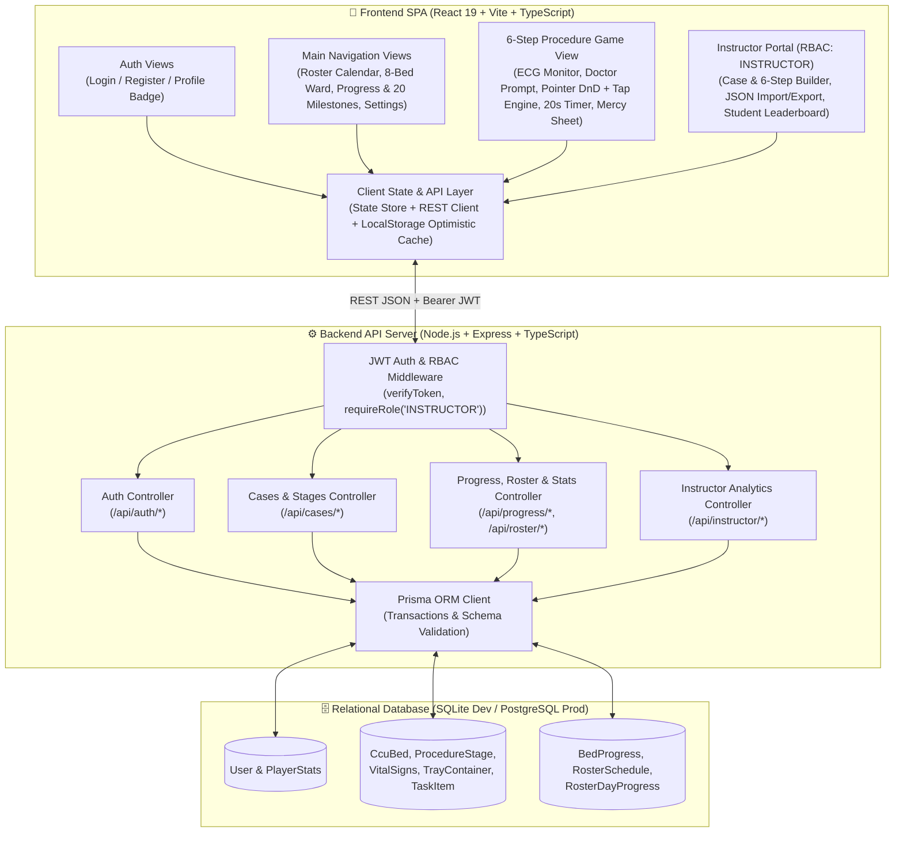
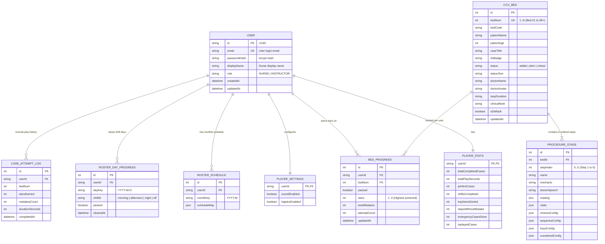

# 🩺 Full-Stack System Analysis & Design (A&D) — A-WARD CCU

> [!IMPORTANT]
> **Full-Stack Architecture Specification (Option 3):**
> - **Frontend:** **React 19 + Vite + TypeScript** preserving 100% of the Chibi/Candy Hospital UI/UX (`prototype/style.css`) + Optimistic LocalStorage Cache.
> - **Backend:** **Node.js + Express + TypeScript + Prisma ORM**.
> - **Database:** **SQLite** (zero-config local dev/testing) & **PostgreSQL** (production-ready via Prisma schema).
> - **Authentication & RBAC:** **JWT + bcryptjs** (`email` & `password`) with two roles:
>   - **`NURSE` (Student / Player):** Plays monthly shift rosters, completes 8-bed CCU clinical procedures, earns stars (`1–3 ⭐`), unlocks 20 milestones, and syncs all progress/stats to the database.
>   - **`INSTRUCTOR` (Admin / Educator):** Accesses the **Case & Step Manager** (CRUD beds, edit 6-step procedures & answer keys, import/export JSON) and views the **Student Progress & Leaderboard Dashboard**.

---

## 1. High-Level Full-Stack System Architecture

---

## 2. Relational Database Schema (Prisma / ER Diagram)

---

## 3. REST API Contracts

### 3.1 Auth Endpoints (`/api/auth`)
- `POST /api/auth/register` — `{ email, password, displayName, role?: "NURSE" | "INSTRUCTOR" }` ➔ `{ token, user }`
- `POST /api/auth/login` — `{ email, password }` ➔ `{ token, user }`
- `GET /api/auth/me` — Bearer JWT ➔ `{ user }`
- `PATCH /api/auth/settings` — Bearer JWT `{ sound?, haptics?, displayName? }` ➔ `{ settings }`

### 3.2 Clinical Cases Endpoints (`/api/cases`)
- `GET /api/cases` — Returns all CCU beds ordered by `bedNum` with `stageData[0..5]`
- `POST /api/cases` (`INSTRUCTOR`) — Create new CCU bed case
- `PUT /api/cases/:bedNum` (`INSTRUCTOR`) — Update bed/patient metadata
- `PUT /api/cases/:bedNum/steps/:stepIndex` (`INSTRUCTOR`) — Update stage vitals, prompt, mechanic, and answer keys
- `DELETE /api/cases/:bedNum` (`INSTRUCTOR`) — Delete bed case and re-index `bedNum`
- `POST /api/cases/import` (`INSTRUCTOR`) — Validate and import JSON case array
- `POST /api/cases/reset-defaults` (`INSTRUCTOR`) — Reset to canonical 8 CCU beds

### 3.3 Progress & Roster Endpoints (`/api/progress`, `/api/roster`, `/api/instructor`)
- `GET /api/progress/me` — Returns `{ progress, playerStats, rosterSchedule, rosterDaysProgress, settings }`
- `POST /api/progress/complete-case` — Atomically saves case completion, updates highest `stars`, increments `PlayerStats`, logs `CaseAttemptLog`, and unlocks next shift day if all shift beds are passed
- `POST /api/progress/heartbeat` — Increments `totalPlaySeconds`
- `POST /api/progress/reset` — Resets user's stars and roster progress
- `PUT /api/roster/:monthKey` — Saves randomized or updated monthly shift schedule
- `POST /api/roster/clear-day` — Marks a shift/off day as passed
- `GET /api/instructor/students` (`INSTRUCTOR`) — Returns student progress & star leaderboard

