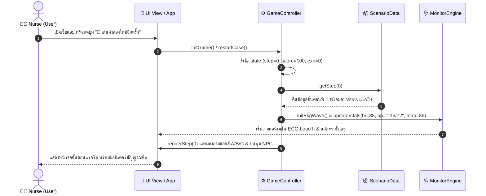
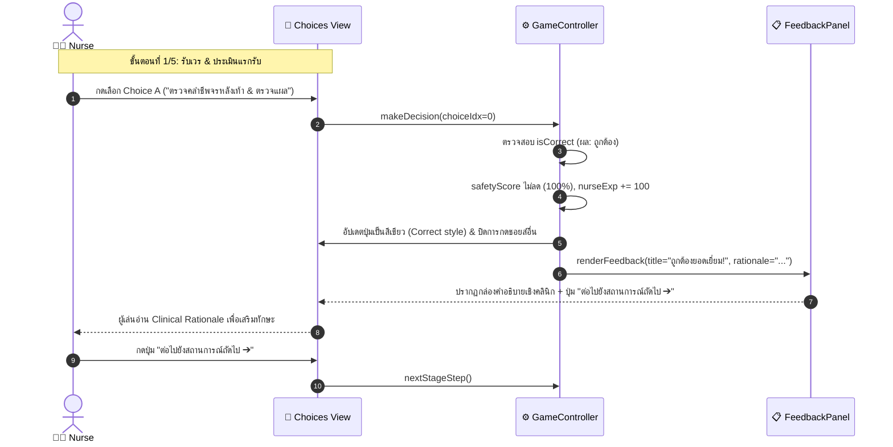
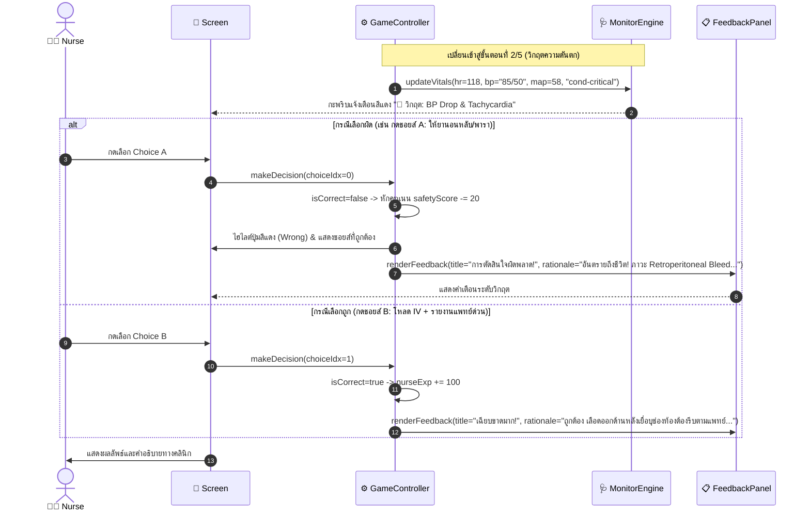
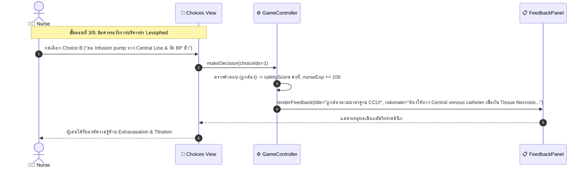
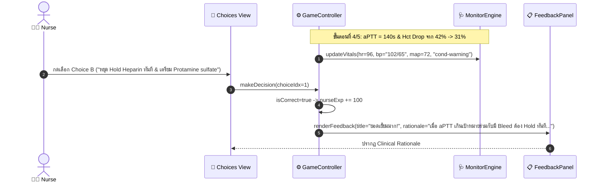
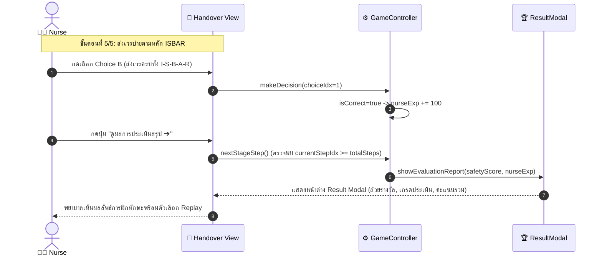
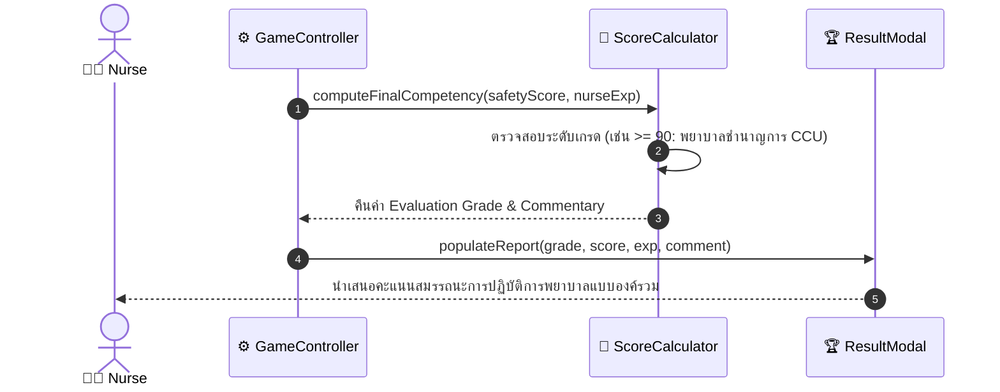

# แผนภาพลำดับขั้นตอน (Sequence Diagrams) สำหรับแต่ละ Use Case
## โครงการ: A-WARD (CCU Nursing Simulation Game)

เอกสารนี้แสดง Sequence Diagram ในการส่งสาร (Message Exchanges) ระหว่าง Actor, หน้าจอผู้ใช้ (UI View), ตัวจัดการเกม (Game Controller), ตัวจำลองสัญญาณชีพ (Vitals & ECG Monitor), และคลังข้อมูลสถานการณ์ (Case Scenario Engine)

---

### 1. Sequence Diagram: UC-01 (Start / Restart Case)



---

### 2. Sequence Diagram: UC-02 (Monitor Vital Signs & Dynamic ECG)

```mermaid
sequenceDiagram
    autonumber
    actor Nurse as 👩‍⚕️ Nurse (User)
    participant UI as 📱 Vitals HUD
    participant Canvas as 📈 ECG Canvas
    participant Loop as ⏱️ Animation Loop (requestAnimationFrame)

    Loop ->> Loop: tick() คำนวณแกน x, y ตามสมการคลื่น EKG
    Loop ->> Canvas: strokeLine(x1, y1, x2, y2)
    Canvas -->> UI: แสดงเส้นคลื่น P-QRS-T เคลื่อนที่แบบ Real-time
    Nurse ->> UI: กวาดสายตาตรวจค่า HR, BP, SpO2, MAP และแถบสถานะผู้ป่วย
```

---

### 3. Sequence Diagram: UC-03 (Assess Initial STEMI Post-PCI)



---

### 4. Sequence Diagram: UC-04 (Manage Retroperitoneal Bleed Deterioration)



---

### 5. Sequence Diagram: UC-05 (Administer Vasoactive Drug - Levophed)



---

### 6. Sequence Diagram: UC-06 (Manage Heparin & Coagulopathy)



---

### 7. Sequence Diagram: UC-07 (Execute ISBAR Handover)



---

### 8. Sequence Diagram: UC-08 & UC-09 (Clinical Feedback & Evaluation Scoring)


