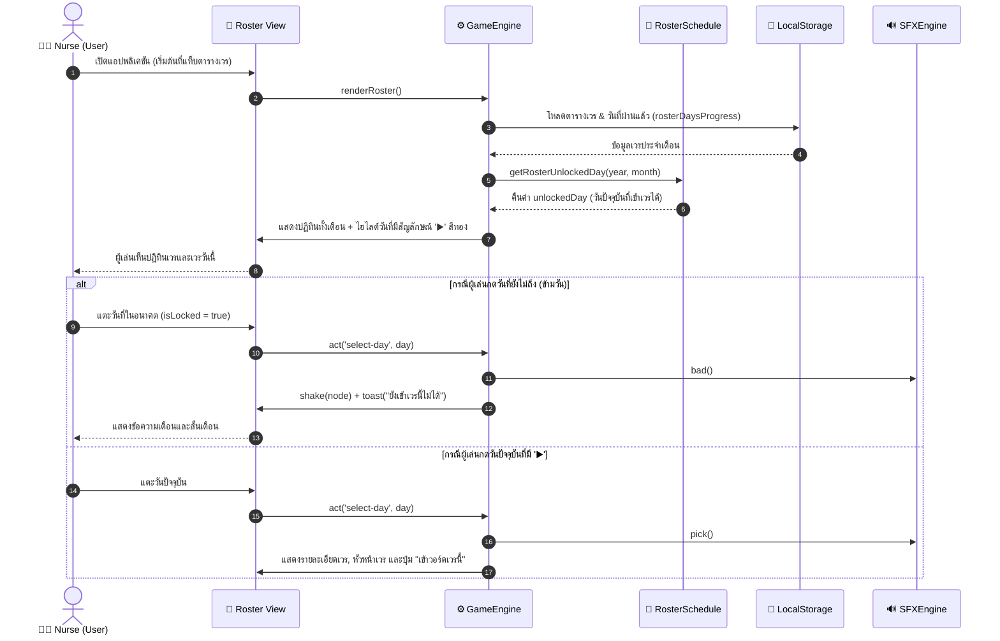
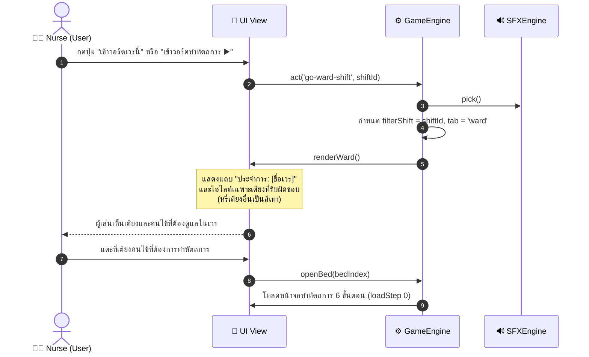
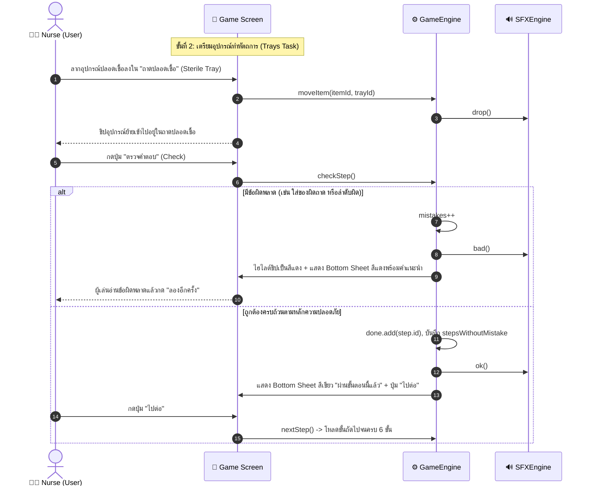
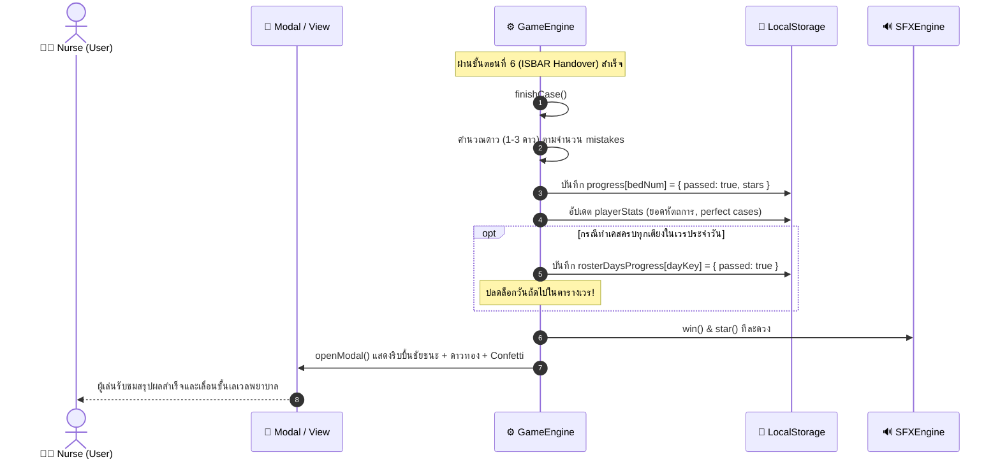
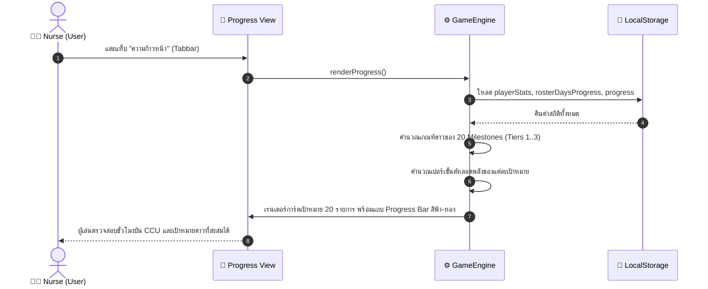

# แผนภาพลำดับขั้นตอน (Sequence Diagrams)
## โครงการ: A-WARD CCU (CCU Nursing Simulation Game)

---

### 1. คำอธิบายภาพรวม (Overview)
เอกสารนี้แสดงการแลกเปลี่ยนข้อความ (Message Sequences) ระหว่างผู้เล่น (Nurse), หน้าจอแสดงผล (UI View), ตัวควบคุมเกม (GameEngine), แหล่งข้อมูลในเครื่อง (LocalStorage), และระบบเสียงสังเคราะห์ (SFXEngine) ตามหน้าจอจริงของ Prototype

---

### 2. Sequence Diagram 1: การเข้าดูตารางเวรและการตรวจเช็กเวรที่เล่นได้ (Roster Calendar Flow)

---

### 3. Sequence Diagram 2: การเข้าสู่วอร์ดและการกรองเตียงตามเวร (Shift to Ward Flow)

---

### 4. Sequence Diagram 3: การทำหัตถการและจัดถาดอุปกรณ์ (Procedure & Multi-tray Drag & Drop)

---

### 5. Sequence Diagram 4: สำเร็จเคสและปลดล็อกวันถัดไปในตารางเวร (Case Finish & Shift Clearance)

---

### 6. Sequence Diagram 5: การติดตามเป้าหมาย 20 Milestones (Milestones Progress Tracking)

