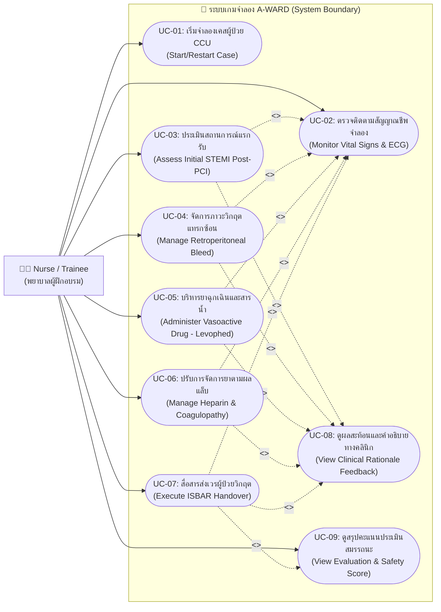

# แผนภาพยูสเคส (Use Case Diagram)
## โครงการ: A-WARD (CCU Nursing Simulation Game)

---

### 1. คำอธิบายภาพรวม (Overview)
แผนภาพ Use Case Diagram นี้แสดงความสัมพันธ์ระหว่าง Actor (พยาบาลผู้ฝึกอบรม / ผู้เล่น) และระบบ A-WARD ประกอบด้วย Use Case หลักในการเข้าเล่นเกมจำลอง การประเมินสัญญาณชีพ การตัดสินใจในภาวะวิกฤต และการประเมินผลสัมฤทธิ์

---

### 2. แผนภาพ Use Case Diagram (Mermaid)

---

### 3. ตารางสรุปรายละเอียด Use Cases (Use Case Descriptions)

| รหัส Use Case | ชื่อ Use Case | คำอธิบายโดยสังเขป |
|---|---|---|
| **UC-01** | Start/Restart Case | ผู้เล่นเริ่มต้นรอบจำลองสถานการณ์ใหม่ หรือกดเริ่มเล่นซ้ำเพื่อฝึกฝน |
| **UC-02** | Monitor Vital Signs & ECG | ผู้เล่นสังเกตค่า HR, BP, SpO2, MAP และคลื่นหัวใจเพื่อประกอบการตัดสินใจ |
| **UC-03** | Assess Initial STEMI Post-PCI | เลือกแนวทางตรวจประเมินแรกรับ (Neurovascular check vs ห้ามยกหัวเตียง) |
| **UC-04** | Manage Retroperitoneal Bleed | วินิจฉัยและรับมือภาวะช็อกซ่อนเร้นหลังแทงสายสวนที่ขาหนีบ |
| **UC-05** | Administer Vasoactive Drug | ปฏิบัติการพยาบาลในการให้ Levophed ทาง Central Line และ Titrate รักษา MAP > 65 |
| **UC-06** | Manage Heparin & Coagulopathy | ติดตามผล aPTT และตัดสินใจ Hold ยา พร้อมเตรียม Protamine antidote |
| **UC-07** | Execute ISBAR Handover | เลือกวิธีการส่งเวรต่อตามหลักการสื่อสารปลอดภัย ISBAR |
| **UC-08** | View Clinical Rationale Feedback | ระบบแสดงผลการตัดสินใจ พร้อมคำอธิบายเชิงวิชาการทางการพยาบาล |
| **UC-09** | View Evaluation & Safety Score | ระบบสรุปคะแนนความปลอดภัยผู้ป่วย (Safety Score) และ EXP |
