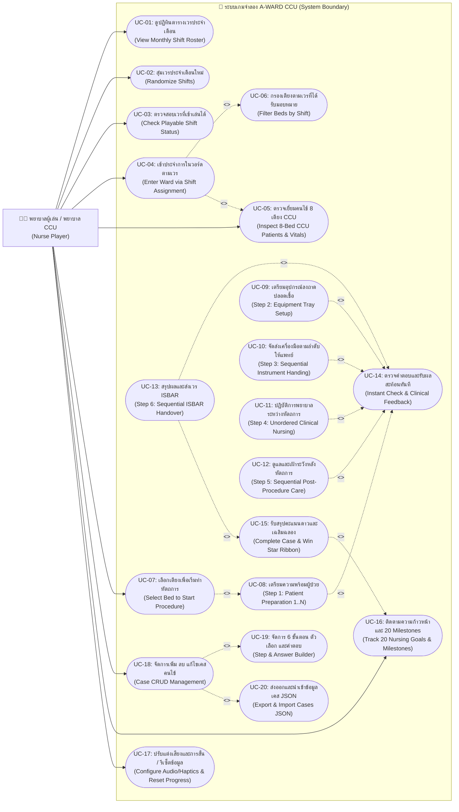

# แผนภาพยูสเคส (Use Case Diagram)
## โครงการ: A-WARD CCU (CCU Nursing Simulation Game)

---

### 1. คำอธิบายภาพรวม (Overview)
แผนภาพ Use Case Diagram นี้แสดงความสัมพันธ์ระหว่าง Actor (พยาบาลผู้เล่น / พยาบาลประจำเวร CCU) และระบบ A-WARD CCU ครอบคลุมการเข้าดูตารางเวรประจำเดือน การขึ้นเวร การเข้าดูแลผู้ป่วยในวอร์ด 8 เตียง การทำหัตถการ 6 ขั้นตอน และการติดตามเป้าหมาย Milestones สะสมดาว

---

### 2. แผนภาพ Use Case Diagram (Mermaid)

---

### 3. ตารางสรุปรายละเอียด Use Cases (Use Case Descriptions)

| รหัส Use Case | ชื่อ Use Case | คำอธิบายโดยสังเขป |
|---|---|---|
| **UC-01** | View Monthly Shift Roster | ดูปฏิทินเวรของเดือน แสดงเวรเช้า/บ่าย/ดึก/Off พร้อมสัญลักษณ์ `✓` สำหรับวันที่ผ่านแล้ว |
| **UC-02** | Randomize Shifts | กดปุ่มสุ่มเวรใหม่ประจำเดือน (🎲 สุ่มเวรใหม่) สำหรับวางแผนการขึ้นเวร |
| **UC-03** | Check Playable Shift Status | ตรวจสอบสถานะการเล่นเรียงวัน โดยแสดงสัญลักษณ์ลูกศร `▶` กรอบสีทองที่วันปัจจุบัน และเตือน "ยังเข้าเวรนี้ไม่ได้" หากกดข้ามวัน |
| **UC-04** | Enter Ward via Shift Assignment | กดปุ่มเข้าวอร์ดจากตารางเวรเพื่อไปยังผังวอร์ด CCU |
| **UC-05** | Inspect 8-Bed CCU Patients | ตรวจสัญญาณชีพจำลอง, แอนิเมชัน ECG, ระยะเวลานอน รพ. และสถานะของทั้ง 8 เตียง |
| **UC-06** | Filter Beds by Shift | ไฮไลต์เฉพาะเตียงที่รับผิดชอบในเวรนั้น และหรี่เตียงอื่นเพื่อโฟกัสงาน |
| **UC-07** | Select Bed to Start Procedure | แตะที่เตียงคนไข้เพื่อเปิดหน้าจอทำหัตถการจำลอง |
| **UC-08** | Step 1: Patient Preparation | ตรวจสอบตัวตน 2 Identifiers, ประเมินข้อบ่งชี้ และเซ็นใบยินยอม (เลือก 1 ถึง N ข้อ) |
| **UC-09** | Step 2: Equipment Tray Setup | ลาก-วางอุปกรณ์ลงถาดสี่เหลี่ยม (แยกถาดปลอดเชื้อ / ขยะติดเชื้อ ไม่จำกัดลำดับ) |
| **UC-10** | Step 3: Sequential Instrument Handing | ลาก-วางส่งเครื่องมือให้แพทย์ตามลำดับความปลอดเชื้อที่ถูกต้อง |
| **UC-11** | Step 4: Unordered Clinical Nursing | ลาก-วางการ์ดปฏิบัติการพยาบาลที่ปลอดภัยลงในโซนหัตถการ |
| **UC-12** | Step 5: Sequential Post-Procedure Care | ลาก-วางเรียงลำดับการดูแลหลังหัตถการ การกดแผล และการตรวจภาวะแทรกซ้อน |
| **UC-13** | Step 6: Sequential ISBAR Handover | ลาก-วางเรียงการส่งเวรอย่างปลอดภัยตามโครงสร้าง ISBAR |
| **UC-14** | Instant Check & Clinical Feedback | ตรวจสอบความถูกต้อง แสดงการ์ดสีแดงเมื่อผิด และให้คำอธิบายทางการพยาบาล |
| **UC-15** | Complete Case & Win Star Ribbon | สรุปคะแนน 1-3 ดาว ปลดล็อกวันถัดไปในตารางเวร พร้อมเอฟเฟกต์ Confetti |
| **UC-16** | Track 20 Nursing Goals & Milestones | ตรวจสอบหลอดพลังและสะสมดาวจาก 20 เป้าหมาย (ชั่วโมงบิน, ยอดหัตถการ, ความแม่นยำ) |
| **UC-17** | Configure Settings & Reset | เปิด-ปิดเสียง SFX, ระบบสั่น Haptic หรือล้างข้อมูลความก้าวหน้าทั้งหมด |
| **UC-18** | Case CRUD Management | บริหารจัดการเคสคนไข้ในวอร์ด เพิ่มเคสใหม่ แก้ไขข้อมูลผู้ป่วย และลบเคส |
| **UC-19** | Step & Answer Builder | กำหนดชื่อขั้นตอน โจทย์แพทย์ สรุปความรู้ และจัดการตัวเลือกคำตอบ พร้อมสลับกลไก (Single choice, Checkbox, Trays, Sequence) |
| **UC-20** | Export & Import Cases JSON | สำรองข้อมูลเคสทั้งหมดออกเป็นไฟล์ JSON และนำเข้าไฟล์เคสกลับสู่ระบบ |
